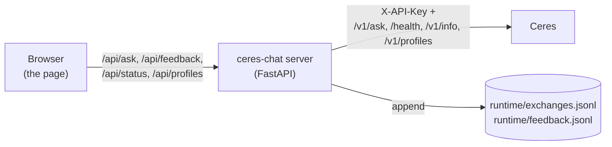

# ceres-chat

A small chat page for trying Ceres, Veridian's agronomy question-answering service.

Ask a question in English or Romanian and see what Ceres returns: the answer or the decline, the citations, and the passages
behind them. Rate each answer with a thumbs up or down and an optional comment. The page also shows whether Ceres is ready, and
on request the per-step timings, the release and route ids, and the raw response.

ceres-chat is a test tool, not a product. It binds to the loopback interface by default and has no login.

## Terms

- **Release**: a versioned set of documents, split into passages and stored for retrieval. Ceres serves one release at a time.
- **Passage**: one piece of a document (a page or a section) that Ceres retrieved for a question, with an evidence id (`E1`…).
- **Citation**: a link from a part of the answer (the claim) to a passage, with the exact supporting words (the quote).
- **Route**: the fixed set of retrieval, reranking and answer settings that Ceres serves, reported as a route id.
- **Profile**: who is asking (a user persona). The page lists the profiles Ceres offers; "no persona" sends none.
- **Conversation**: a series of questions that share a conversation id, so that Ceres can answer follow-ups ("And for maize?").
  The page starts a new conversation when it loads, when you press "New conversation", and when you change the profile.

## How it works



The browser talks only to the ceres-chat server. The server adds the Ceres API key and forwards the question, so the key
never reaches the browser.

## Install

Requirements: Python 3.12 and [uv](https://docs.astral.sh/uv/).

```bash
bash setup_venv.sh
```

The script creates `.venv/`, installs the locked dependencies (`uv.lock`), and runs the test suite. It needs no Ceres, no GPU
and no network beyond package download. It is safe to run again.

## Quick start without a GPU

`tools/fake_ceres.py` is a stand-in Ceres. It replays recorded responses, so you can try the page without a real Ceres.

```bash
cp config.example.yaml config.yaml

# Terminal 1: the fake Ceres on a free local port (8399 here).
.venv/bin/python tools/fake_ceres.py 8399

# Terminal 2: the chat, pointed at the fake Ceres.
CERES_CHAT_CERES__URL=http://127.0.0.1:8399 CERES_CHAT_SERVER__PORT=8311 CERES_API_KEY=any \
  .venv/bin/python -m ceres_chat
```

Open http://127.0.0.1:8311/ . The status badge shows "Ceres ready". Stop each server with Ctrl-C.

The fake Ceres accepts any key and picks its reply from the question text:

| Question contains | Reply |
|---|---|
| `2008` or `yield` | a recorded decline (`UNSUPPORTED`, `NO_RELEVANT_SUPPORT`) |
| `busy` | HTTP 429, shown as an error |
| `slow` | the recorded answer after a 3 s wait |
| anything else | a recorded answer with one citation |

The fake has no profiles, so the profile list stays at "no persona". If port 8399 or 8311 is in use, pick other free ports and
change both commands.

## Running against a real Ceres

This requires a running Ceres service with its document store, answer model and reranker, and its API key.

1. Copy the template: `cp config.example.yaml config.yaml` (`config.yaml` is git-ignored).
2. Set `ceres.url` to the Ceres base URL.
3. Give the chat the API key in one of two ways. Never write the key itself in `config.yaml`.
   - an environment variable: export the key in the variable named by `ceres.api_key_env` (default `CERES_API_KEY`), or
   - a key file: set `ceres.api_key_file` to a file whose first line is the key. A relative path is resolved from the
     folder of the config file. A missing file stops startup.
4. Start the chat: `.venv/bin/python -m ceres_chat`, then open `http://127.0.0.1:8310/`.

Without a key the server prints a warning, and Ceres rejects every question. The status badge then shows
"Ceres rejects the key".

### Configuration

| Key | Default | Meaning |
|---|---|---|
| `ceres.url` | required | Ceres base URL. |
| `ceres.api_key_env` | `CERES_API_KEY` | Name of the environment variable that holds the key. |
| `ceres.api_key_file` | `null` | Path to a key file. When set, it is used instead of the variable. |
| `ceres.timeout_s` | `300` | How long the server waits for an answer. |
| `server.host` | `127.0.0.1` | Listen address. Keep it on loopback: the page has no login. |
| `server.port` | `8310` | Listen port. |
| `runtime_dir` | `runtime` | Where the logs go. A relative path is resolved from the folder of the config file. |

Every key can be overridden with an environment variable `CERES_CHAT_<SECTION>__<KEY>` (double underscore), for example
`CERES_CHAT_CERES__URL` or `CERES_CHAT_SERVER__PORT`. The top-level `runtime_dir` has no section, so its variable is
`CERES_CHAT_RUNTIME_DIR` (a relative value is resolved from the folder of the config file). `CERES_CHAT_CONFIG` names another config file instead of `config.yaml`.

### Status badge

| Badge | Meaning |
|---|---|
| Ceres ready | `/health` reports ready; the badge also shows the release id. |
| Ceres not ready | Ceres is up but still loading or warming up. |
| Ceres down | `/health` does not answer. |
| Ceres rejects the key | `/v1/info` returns 401. |
| chat server unreachable | the page cannot reach the ceres-chat server. |

## What it records

The server appends one JSON line per event under `runtime_dir`. Both files are git-ignored. The API key is never written.

- `exchanges.jsonl`: one line per question, with `exchange_id`, time (`at`, UTC), `question`, `lang`, the `conversation_id`
  and `profile_id` when set, the full Ceres response (`ceres`) or the error (`error`), and the round-trip time (`latency_ms`).
- `feedback.jsonl`: one line per rating, with time, `exchange_id`, `rating` (`up` or `down`) and `comment`.

Errors returned to the page have the shape `{"error": {"kind", "status", "detail"}}`, with kinds `ceres_down` (Ceres
unreachable), `timeout`, `key_rejected` (Ceres returned 401) and `ceres_error` (any other Ceres error, with its detail).

## Testing

```bash
.venv/bin/python -m pytest -q tests
```

The suite (29 tests) runs the real server code against a fake Ceres that serves recorded responses. It needs no GPU and no
network, but it does need permission to open loopback (127.0.0.1) sockets: in a sandbox that blocks socket creation the
tests hang or fail. It checks that the key is sent to Ceres but never returned to the browser or logged, that bad input never reaches
Ceres, that declines and errors pass through unchanged, that every exchange is logged, the feedback rules, the status states,
the conversation and profile fields, and the configuration rules. `smoke_test.py` runs the same suite and is called by
`setup_venv.sh`.

## Test data sources

The test data quotes passages, tables or page text from 5 public JRC MARS Bulletins (European Commission, Joint Research Centre), for testing only. Of these 5 documents, 5 state "Reproduction is authorised provided the source is acknowledged". The rest of the test data is invented or recorded from this software's own runs. Third-party material keeps its own terms; the proprietary licence covers the rest of the repository.

## License

Proprietary. See LICENSE.
